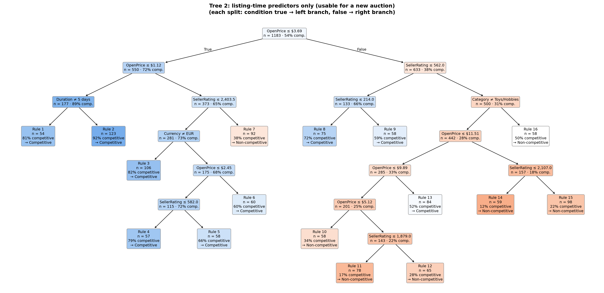
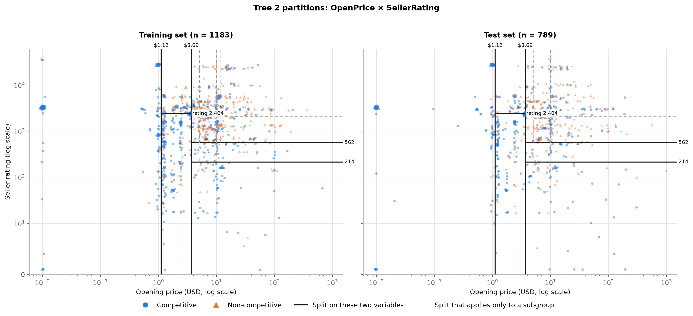

# Competitive eBay Auctions: Classification Trees vs. k-NN

RSM8413 Machine Learning Analytics, Group Assignment 2 (Fall 2026)

Will an eBay auction attract at least two bids? And which settings the seller controls make that more likely?
The data cover 1,972 auctions from May–June 2004 (`eBayAuctions.xlsx`).

## Approach in one paragraph

A first classification tree uses every variable, including `ClosePrice`. It scores 82%, but `ClosePrice` is only known after the auction ends (target leakage), so it can't be used to predict a new auction. A second tree uses only **listing-time** variables (category, currency, seller rating, duration, end day, opening price) and is the model that matters. It is compared with k-NN on the same 60/40 split. Two extra checks guard against misleading conclusions: comparing each seller with themselves (to separate real levers from "who uses that setting"), and testing on sellers the model has never seen.

## Key findings

| | Test accuracy |
|---|---|
| Naive guess (always "competitive") | 54.1% |
| Tree 1: all predictors (leaky, not usable) | 82.0% |
| **Tree 2: listing-time predictors** | **72.0%** |
| k-NN (k = 13, listing-time predictors) | 71.1% |

- **Opening price is the main lever.** Starts of about \$1 or less gave competitive auctions 80–90% of the time. Above \$3.69, most auctions from established sellers were not competitive. The effect holds up when the same seller is compared across their own auctions.
- **Duration, end day and currency only look important in raw tables.** The apparent "Monday" and "5-day" effects come from a handful of large sellers, and they disappear in same-seller comparisons.
- **The tree beats k-NN on business value.** It is equally accurate, explainable as 16 if-then rules, and holds up better for new sellers (65.7% vs. 60.3%).
- **Prices are already in USD.** €1 shows up as \$1.23 and £1 as \$1.77, so `Currency` identifies the marketplace rather than the unit.




## Repository contents

```
.
├── ebay_competitive_auctions.ipynb   # the full analysis (the single submission file)
├── eBayAuctions.xlsx                 # data; must sit in the same folder as the notebook
├── figures/                          # every chart, regenerated by the notebook
├── requirements.txt
└── README.md
```

## How to run

```bash
pip install -r requirements.txt
jupyter notebook ebay_competitive_auctions.ipynb
```

Then **Kernel → Restart & Run All**. The notebook loads the data by relative path, fixes all random seeds (`RANDOM_STATE = 1`), and writes every figure to `figures/`. It takes about 15 seconds.

The results shown were produced with Python 3.13, pandas 3.0, scikit-learn 1.9, matplotlib 3.11 and numpy 2.5. Older library versions should run the notebook unchanged, but the last decimals could differ slightly.

## Notebook structure

1. Load and clean (remove the summary rows under the data)
2. Understand the data: raw patterns, leakage, currency, seller concentration
3. Pre-processing: dummies for all levels; scaling only for k-NN
4. Stratified 60/40 train/test split
5. Tree 1 (all predictors) → rules, importance, why it isn't practical.
   Tree 2 (listing-time) → rules, diagram, scatter partition, classification tables, seller settings, recommendations
6. k-NN: k chosen by 5-fold CV on the training set only; comparison with Tree 2
7. Robustness: 30 random splits, 30 seller-grouped splits
8. Key numbers and summary
